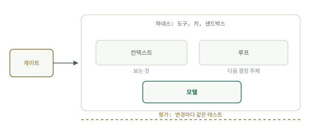

# 다섯 계층, 하나의 시스템

에이전트를 출근 첫날의 신입 사원이라고 생각해 보십시오. 똑똑하고 빠르지만 회사에 대해서는 아무것도 모릅니다. 그가 성공할지는 전적으로 그 주위에 세운 시스템에 달려 있고, 그 시스템에는 정확히 다섯 계층이 있습니다.

업계는 이 계층들을 서로 경쟁하는 학파처럼 이야기합니다. 컨텍스트 엔지니어링, 루프 엔지니어링, Jev 엔지니어링, 하네스 엔지니어링, 평가 엔지니어링. 유행어 다섯 개, 컨퍼런스 트랙 다섯 개, 나머지 넷은 거품이라고 말하는 사람 다섯 명입니다. 이들은 경쟁하는 접근이 아닙니다. 하나의 시스템을 이루는 다섯 계층이며, 각각 하나의 질문에 답합니다. 무엇을 보는가, 누가 결정하는가, 누가 분류하는가, 무엇에 닿을 수 있는가, 어떻게 아는가.

## 컨텍스트: 무엇을 보는가

일을 시작할 때 그의 책상 위에 놓인 것입니다. 업무 지시서, 관련 파일, 중요한 이력 한 장, 그리고 그 밖에는 아무것도 없습니다. 모델은 윈도 안에 있는 것만 가지고 추론하며, 바깥의 모든 것은 존재하지 않는 것과 같습니다. 이 계층이 없으면 에이전트는 추측합니다. 본 적 없는 질문에 그럴듯한 답을 지어내고, 이미 받은 것을 다시 요청합니다. 나쁜 컨텍스트는 흔히 나쁜 모델로 오진됩니다.

## 루프: 누가 결정하는가

그는 체크리스트대로 일하는가, 아니면 다음 단계를 스스로 정하는가? 체크리스트는 워크플로입니다. 싸고 예측 가능하지만 첫 번째 돌발 상황에서 죽습니다. 스스로 정하는 단계가 에이전트 루프입니다. 유연하고 비싸며, 헤맬 수 있습니다. 루프를 의도적으로 설계하지 않으면 둘 중 하나의 실패를 겪습니다. 예상 밖의 일에 부서지는 스크립트이거나, 같은 파일 세 개를 맴돌며 토큰만 태우는 방랑자입니다.

## 게이트: 누가 분류하는가

우편물을 분류하는 안내 데스크입니다. 모든 요청이 비싼 직원을 받을 자격이 있는 것은 아닙니다. 분류기, 값싼 모델, 규칙 같은 작고 빠른 결정이 사소한 일은 밖으로 돌리고 진짜 일만 안으로 들입니다. 게이트가 없으면 쓰레기, 중복, 열쇠를 쥔 에이전트에게는 애초에 닿아서는 안 될 트래픽까지 모든 것이 가장 비싼 경로로 들어갑니다.

## 하네스: 무엇에 닿을 수 있는가

그의 사무실입니다. 책상 위의 도구, 열쇠고리의 열쇠, 일이 나가기 전에 검토하는 사람. 권한, 샌드박스, 타임아웃, 검토가 여기에 속합니다. 하네스가 없으면 에이전트는 쓸모가 없거나(결정할 수는 있으나 행동하지 못함) 위험합니다(모든 것에 행동할 수 있는데, 행동이 닿기 전에 아무도 살피지 않음).

## 평가: 어떻게 아는가

매달 같은 시험입니다. 데모도, 프롬프트를 바꾼 뒤의 느낌 확인도 아닙니다. 답이 알려진 고정된 과제 묶음을 모든 버전에서 실행합니다. 평가가 없으면 변경이 도움이 됐는지 느낌으로만 알 수 있고, 회귀는 사용자가 발견하게 됩니다.

## 지도

한 계층의 실패는 다른 계층의 가면을 씁니다. 컨텍스트 부족은 멍청한 모델로 보이고, 게이트 부족은 폭주하는 비용으로 보이며, 평가 부족은 프로덕션에 가기 전까지는 아무 문제도 없는 것처럼 보입니다. 계층마다 이 강좌의 모듈이 하나씩 있고, 네 계층에는 핸드북도 있습니다. 이 구분이 사이트 전체의 약속입니다. 모듈은 개념을 순서대로 한 번 가르치고, 핸드북은 그 계층이 아파지기 시작할 때를 위해 기법, 도구, 실습의 전체 메뉴를 담습니다.

| 계층 | 질문 | 모듈 | 핸드북 |
| --- | --- | --- | --- |
| 컨텍스트 | 무엇을 보는가? | [모듈 1: 모델은 어떻게 읽는가](../course-1-context/how-models-read.md) | 모듈 1이 심화 과정입니다 |
| 루프 | 다음 단계는 누가 정하는가? | [모듈 2: 루프와 워크플로](../course-2-loop/loops-vs-workflows.md) | [루프 엔지니어링이란 무엇인가](../track-loop/what-loop-engineering-is.md) |
| 게이트 | 들어오는 일은 누가 분류하는가? | [모듈 3: 값싼 결정](../course-3-gate/cheap-decisions.md) | [시스템 1 모델](../track-jev/system-one-models.md) |
| 하네스 | 무엇에 닿을 수 있는가? | [모듈 4: 사무실](../course-4-harness/the-office.md) | [하네스란 무엇인가](../track-harness/what-a-harness-is.md) |
| 평가 | 제대로 동작하는지 어떻게 아는가? | [모듈 5: 두 가지 점검](../course-5-evals/two-kinds-of-checks.md) | [왜 평가인가](../track-evals/why-evals.md) |

## 스스로 점검하기

- 에이전트가 두 단계 전까지 컨텍스트에 있던 파일을 계속 다시 요청합니다. 어느 계층이 고장 났으며, 왜 모델 문제처럼 보입니까?
- 동료가 평가 엔지니어링이 프롬프트 엔지니어링을 대체했다고 주장합니다. 다섯 가지 질문을 사용해, 이 주장이 왜 범주 오류인지 설명하십시오.
