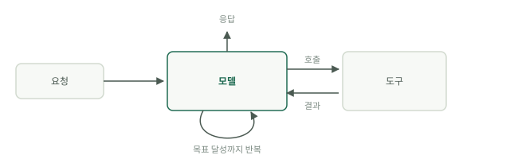

# 에이전트란 무엇인가

Google의 [Introduction to Agents](https://www.kaggle.com/whitepaper-introduction-to-agents) 화이트페이퍼(Kaggle, 2025년 11월)는 에이전트를 질문에 답하는 모델이 아니라, 목표를 이루기 위해 계획을 세우고 행동하는 애플리케이션으로 정의합니다. 정의는 밋밋하게 들리지만 그 함의는 그렇지 않습니다. 모델은 네 구성 요소 중 하나일 뿐이며, 대개 고장 나는 쪽도 아닙니다.

## 모델, 도구, 오케스트레이션

화이트페이퍼는 네 구성 요소를 꼽습니다. 모델은 두뇌입니다. 다음에 무엇을 할지 정하는 추론 엔진입니다. 도구는 손입니다. API, 코드 실행, 데이터베이스 질의 등 추론이 현실 세계에 작용하게 해 주는 모든 것입니다. 오케스트레이션 계층은 신경계입니다. 컨텍스트를 조립하고, 모델을 호출하고, 모델이 요청한 것을 실행하고, 결과를 다시 넣어 주는 루프입니다. 배포는 몸입니다. 호스팅, 로깅, 모니터링 같은 눈에 띄지 않는 나머지입니다.

루프는 사람들이 과소평가하는 부분입니다. 화이트페이퍼는 생각-행동-관찰 사이클을 설명합니다. 에이전트는 임무를 받고, 가진 것을 살피고, 한 단계를 계획하고, 실행하고, 일어난 일을 보고, 목표가 이뤄질 때까지 다시 돕니다. 겉포장을 걷어 내면 에이전트는 단계 사이마다 모델의 컨텍스트를 다시 만들어 주는 루프입니다.

## 자율성의 다섯 수준

화이트페이퍼는 시스템을 이분법이 아니라 수준으로 나눕니다.

- 수준 0: 학습 데이터만으로 추론하는 순수한 모델. 도구도 메모리도 없습니다.
- 수준 1: 연결된 문제 해결사. 모델에 도구가 붙어, 모르는 것을 가져올 수 있습니다.
- 수준 2: 전략적 문제 해결사. 다단계 계획과 의도적인 컨텍스트 엔지니어링을 합니다.
- 수준 3: 협업하는 멀티 에이전트 시스템. 전문 에이전트들이 서로를 도구로 다룹니다.
- 수준 4: 스스로 진화하는 시스템. 능력의 빈틈을 발견하면 새 도구나 에이전트를 만듭니다.

오늘날 프로덕션에 나가는 것의 대부분은 수준 1과 2에 있습니다. 비판이 아닙니다. 실제로 성과가 나는 곳이 거기입니다.

## 챗봇도 워크플로도 아닌 것

챗봇은 한 번에 메시지 하나에 답하며, 다음 단계는 모두 사람이 정합니다. Anthropic의 정의에서 워크플로는 모델 호출과 도구가 미리 작성한 코드 경로를 따라 실행되는 시스템입니다. 에이전트는 모델이 스스로 과정을 이끄는 시스템으로, 방금 관찰한 것을 바탕으로 다음 단계를 정합니다. 가르는 질문은 늘 같습니다. 다음에 무슨 일이 일어날지 누가 정하는가, 사람인가, 코드인가, 모델인가?

## 에이전트가 제값을 하는 곳

화이트페이퍼의 사례는 범위가 넓습니다. 작은 쪽에는 고객 지원 에이전트가 있습니다. "내 주문 어디 있나요?"라는 질문을, 스크립트로 짠 결정 트리 대신 주문 조회 API와 배송 추적 API를 직접 호출해 해결합니다. 큰 쪽에는 Google의 Co-Scientist가 있습니다. 감독자가 생성, 성찰, 순위 매기기, 진화, 메타 리뷰를 맡은 전문 에이전트들에게 일을 맡겨, 몇 시간 또는 며칠에 걸쳐 과학적 가설을 다듬습니다. AlphaEvolve는 후보 알고리즘을 제안하고 테스트하며, 데이터센터 효율과 행렬 곱셈에서 개선을 만들어 냈습니다.

이 사례들의 공통점은 이렇습니다. 단계는 미리 적어 둘 수 없지만 결과는 확인할 수 있습니다. 단계를 적을 수 있다면 적으십시오. 그 이야기는 [에이전트인가 워크플로인가](agents-or-workflows.md)에서 다룹니다. 그리고 네 구성 요소는 일꾼 한 명의 해부도일 뿐이고, 그를 둘러싼 시스템이 [다섯 계층](five-layers.md)입니다.

## 스스로 점검하기

- 화이트페이퍼가 에이전트에 부여한 네 구성 요소를 말해 보십시오. 생각-행동-관찰 루프는 그중 어느 것에 들어 있습니까?
- 시스템이 분기 없이 정해진 순서로 모델을 세 번 호출합니다. 어느 수준이며, 에이전트입니까?
