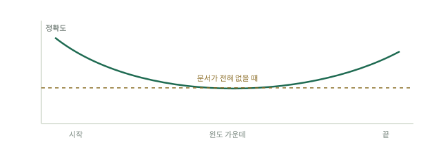

# 모델은 컨텍스트를 어떻게 읽는가

더 큰 컨텍스트 윈도는 공짜 용량처럼 보입니다. 그렇지 않습니다. 모델은 보낸 모든 토큰을 읽지만 똑같은 비중으로 따지지는 않으며, 어느 선을 넘으면 토큰이 하나 늘 때마다 답이 느려지고 비싸질 뿐 아니라 나빠지기까지 합니다. 이 페이지는 작동 원리를 다루고, [네 곳](the-four-places.md)은 그 위에 세운 실천 규율을 다룹니다.

## 어텐션의 모양

[Lost in the Middle](https://arxiv.org/abs/2307.03172)(중간 내용 소실, Liu 외, 2023)에서 모델들은 검색해 온 문서 더미를 바탕으로 질문에 답했고, 그동안 정답이 든 문서 하나는 더미 안에서 위치를 옮겨 다녔습니다. 문서가 20개일 때 GPT-3.5-Turbo는 정답이 첫 번째 문서에 있으면 75.8%, 가운데 있으면 53.8%, 끝에 있으면 63.2%를 기록했습니다. 클로즈드북 기준선, 즉 문서를 아예 주지 않고 같은 질문을 한 경우는 56.1%였습니다. 정답이 윈도 안에 분명히 있는데 가운데 묻혀 있으면, 모델은 아무것도 없을 때보다 못했습니다.

같은 U자형 곡선이 GPT-3.5-Turbo(4K와 16K), Claude 1.3(100K 변형 포함), MPT-30B-Instruct, LongChat-13B 전반에서, 그리고 문서 10개, 20개, 30개 더미 전반에서 나타났습니다. 모델은 윈도의 시작(초두 효과, primacy)과 끝(최신 효과, recency)에는 강하게, 그 사이의 모든 것에는 약하게 주목합니다. 더 새로운 모델은 곡선을 평평하게 만들지만, 곡선을 없앤 모델은 아직 없습니다. Google의 백서 [Context Engineering: Sessions & Memory](https://www.kaggle.com/whitepaper-context-engineering-sessions-and-memory)(Milam과 Gulli, 2025년 11월)는 이보다 넓은 의미의 실패를 "컨텍스트 부패(context rot)"라고 부릅니다. 컨텍스트가 커질수록 모델이 핵심 정보에 주의를 기울이는 능력이 줄어든다는 것입니다.

## 토큰 하나당 네 가지 비용

같은 백서는 긴 컨텍스트의 현실적 한계 네 가지를 듭니다. 윈도 하드 한도, API 비용, 지연 시간, 품질입니다. 윈도 한도는 사람들이 가장 두려워하지만 가장 늦게 문제가 되는 한계입니다. 비용, 지연 시간, 품질은 불필요한 첫 토큰부터 계속 나빠집니다.

비용은 에이전트 루프에서 복리로 불어납니다. 매 턴이 전체 히스토리를 다시 보내므로, N턴짜리 루프는 컨텍스트 값을 대략 N번 치릅니다. 쓸모없는 짐 20,000토큰을 진 채 30턴을 도는 실행이 낭비하는 것은 20,000토큰이 아니라 약 600,000토큰입니다. 지연 시간도 같은 식으로 늘어나고, 품질은 신경 쓰는 신호가 윈도의 약한 가운데로 밀려나면서 떨어집니다.

## 프롬프트 캐싱, 변하지 않는 것에 대한 보상

제공사는 바뀌지 않은 프리픽스를 큰 폭으로 할인해 다시 내줍니다. Anthropic의 [프롬프트 캐싱](https://platform.claude.com/docs/en/docs/build-with-claude/prompt-caching)은 대부분의 모델에서 캐시 읽기를 기본 입력 요율의 0.1배, 즉 열 배 싸게 책정하며, 캐시 쓰기는 기본 수명인 5분짜리가 1.25배(1시간짜리 캐시는 2배)입니다.

함정은 엄격함입니다. 캐시가 적중하려면 캐시 브레이크포인트까지의 프리픽스가 바이트 단위로 100% 같아야 합니다. 캐시는 도구, 시스템 프롬프트, 메시지 순의 계층 구조여서, 도구 정의 하나를 고치면 그 뒤의 모든 것이 무효가 되고, 시스템 프롬프트를 조금이라도 바꾸면 메시지 히스토리 캐시 전체가 무효가 됩니다. 시스템 프롬프트에 타임스탬프가 있으면 호출마다 반드시 빗나가고, 아무 소리 없이 10배를 고스란히 치르게 됩니다. 캐시할 수 있는 최소 길이도 있습니다. 모델에 따라 512토큰에서 4,096토큰 사이이며, 그보다 짧으면 오류 없이 캐싱이 건너뛰어집니다.

## 해법의 모양

원리는 한 방향을 가리킵니다. 절대 바뀌지 않는 내용은 맨 앞에 둡니다. 그곳은 싸고(캐시됨) 어텐션도 잘 받습니다(초두 효과). 지금 중요한 내용은 맨 끝에 둡니다. 그곳에서는 최신 효과가 도와줍니다. 크거나 일시적인 것은 모두 윈도 밖, 디스크에 두고 필요할 때 가져옵니다. 이 배치 규율이 다음 페이지이며, 하네스 핸드북에는 이를 실제 에이전트에 연결하는 [더 깊은 설명](../track-harness/context-engineering.md)이 있습니다.
