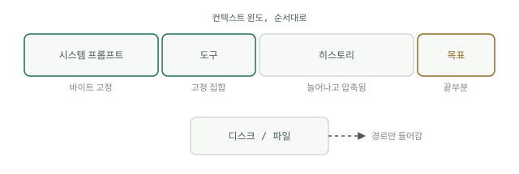

# 네 곳

[모델은 어떻게 읽는가](how-models-read.md)는 기본 원리를 확립했습니다. 어텐션은 윈도의 시작과 끝을 선호하고, 토큰은 하나하나 비용이 들며, 캐싱은 프리픽스가 움직이지 않을 때만 값을 합니다. 거기서 나오는 규율은 말로 하기 간단합니다. 컨텍스트 조각은 모두 네 곳 중 정확히 한 곳에 속하며, 에이전트 문제 대부분은 엉뚱한 곳에 놓인 무언가로 거슬러 올라갑니다.




<a id="one-the-system-prompt"></a>

## 하나: 시스템 프롬프트

모든 호출에서 참인 것만 둡니다. 페르소나, 절대 규칙, 출력 형식, 그 밖에는 아무것도 두지 않습니다. 바이트 단위로 안정적이어야 합니다. 타임스탬프도, 사용자 이름도, 검색해 온 메모리도, "현재 작업"도 안 됩니다. 시스템 프롬프트에 동적인 것이 하나라도 있으면 요청마다 캐시가 깨지고(캐시 계층에서 시스템은 메시지보다 위에 있습니다), 그런 내용이 필요 없는데도 초두 효과가 작용하는 자리를 낭비합니다. 시스템 프롬프트를 고치는 일은 손질이 아니라 릴리스로 다루십시오.

<a id="two-the-tools"></a>

## 둘: 도구

도구 집합은 대화 내내 고정합니다. 실행 도중에 정의를 추가하거나 빼지 마십시오. 도구는 캐시 계층의 맨 앞에 있어서, 하나만 건드려도 캐시된 프리픽스 전체가 무효가 되고, 그 밑에서 모델의 동작도 달라집니다. 도구를 못 쓰게 해야 한다면 대신 호출을 막으십시오. 호출을 가로채 "이 도구는 이 작업에서 비활성화되었습니다"를 돌려주고, 정의는 그대로 둡니다.

정의는 비쌉니다. Anthropic의 [Advanced tool use](https://www.anthropic.com/engineering/advanced-tool-use) 글(2025년 11월)은 일반적인 서버 5개짜리 MCP 구성에서 도구 58개가 대화를 시작하기도 전에 약 55K토큰을 차지한다고 측정했고, 내부에서는 최적화 전에 정의만 134K토큰에 이르는 것을 보았다고 밝혔습니다. 도구가 스무 개 안팎까지는 전부 로드해 두고, 그 이상이면 [컨텍스트 실습](context-practice.md)에서 다루는 도구 검색으로 바꾸십시오.

<a id="three-the-disk"></a>

## 셋: 디스크

크거나 오래 가는 것은 모두 파일에 넣고, 윈도에는 경로만 들어옵니다. 내용이 아니라 키를 남기십시오. 40,000토큰짜리 페이지를 가져오는 도구는 그 페이지를 돌려주면 안 됩니다.

```python
import hashlib, pathlib, urllib.request

def fetch_to_disk(url: str) -> str:
    text = urllib.request.urlopen(url).read().decode("utf-8", "replace")
    path = pathlib.Path("cache") / (hashlib.sha1(url.encode()).hexdigest() + ".txt")
    path.parent.mkdir(exist_ok=True)
    path.write_text(text, encoding="utf-8")
    return f"saved {len(text)} chars to {path}"
```

에이전트는 필요할 때 파일의 일부 구간을 읽습니다. 윈도에는 문서 대신 15토큰짜리 영수증이 들어 있습니다.

<a id="four-the-tail"></a>

## 넷: 끝부분

윈도의 끝은 가진 자리 중 어텐션을 가장 잘 받는 목 좋은 자리입니다. 몇 단계마다 그곳에 현재 목표를 다시 적으십시오. 최신 도구 결과 뒤에 한두 줄을 덧붙이면 됩니다. 긴 루프에서는 처음 지시가 약한 가운데로 밀려나 있습니다. 턴마다 30토큰을 들여 끝부분에 다시 적어 주는 것이 모델을 작업에서 벗어나지 않게 붙들어 줍니다.

<a id="what-survives-the-session"></a>

## 세션이 끝나도 남는 것

Google의 [Sessions & Memory](https://www.kaggle.com/whitepaper-context-engineering-sessions-and-memory) 백서는 선을 깔끔하게 긋습니다. 세션은 대화 한 번을 위한 작업대이고, 메모리는 대화를 넘어 남는 서류함입니다. 이 정의가 중요합니다. 메모리는 추출한 정보이지 원본 대화가 아닙니다. 트랜스크립트를 보관하는 것이 아니라, 추출을 실행하고(LLM이 선호, 결정, 목표처럼 정해 둔 주제에 맞는 사실만 뽑아냅니다) 이어서 통합을 실행합니다. 통합에서는 새 사실을 기존 사실과 비교해 병합하거나 갱신하고, 모순되면 삭제합니다. 두 작업은 모두 응답을 보낸 뒤 백그라운드에서 돌며, 응답 경로에서는 절대 돌지 않습니다. 세션 사이에 남기는 것은 정제된 기록입니다. 안정적인 선호, 계속 유효한 결정, 힘들게 얻은 사실입니다. 트랜스크립트는 출처 기록으로 디스크에 남습니다.

<a id="compacting-the-window"></a>

## 윈도 압축

진행 중인 세션에 대해 백서는 정교함이 높아지는 순서로 세 가지 전략을 듭니다. 최근 N턴만 유지하기(슬라이딩 윈도), 토큰 기반 잘라내기(최신 것부터 예산을 채움), 재귀적 요약(오래된 턴을 롤링 요약으로 바꾸어 최근 원문 턴 앞에 붙임)입니다. 압축은 개수 임계값, 비활동, 작업 완료 중 하나를 기준으로 시작합니다. 루프 핸드북의 [컨텍스트 위생](../track-loop/context-hygiene.md) 페이지는 오래 도는 루프 안의 압축을 더 깊이 다룹니다.
