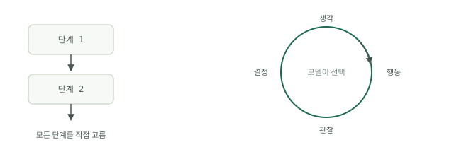

# 루프 대 워크플로

워크플로는 미리 써 둔 순서입니다. 1단계, 2단계, 3단계, 끝입니다. 루프는 딱 한 곳이 다릅니다. 다음 단계를 실행 시점에 모델이 방금 일어난 일을 바탕으로 고른다는 점입니다. 사이클은 생각, 행동, 관찰, 결정의 반복입니다. 모델이 행동을 제안하고, 그 행동이 실행되고, 결과가 히스토리로 돌아오고, 한 바퀴 더 돌지는 무언가가 결정합니다. Google의 "Introduction to Agents" 화이트페이퍼(Kaggle, 2025)는 같은 사이클을 임무 받기, 상황 훑기, 깊이 생각하기, 행동하기, 그다음 관찰하고 반복하기로 그리며, 모델, 도구, 오케스트레이션의 삼각 구도 위에서 돌아간다고 합니다. 어휘는 달라도 모양은 같습니다.

## 다음 단계는 누가 고르는가

구분은 이것이 전부입니다. 워크플로에서는 설계 시점에 모든 단계를 직접 골랐고, 코드는 그 결정을 되풀이해 재생할 뿐이라 같은 입력은 실행할 때마다 같은 길을 갑니다. 루프에서는 모델이 실행 시점에 고르므로 같은 입력의 두 번 실행이 다른 길을 갈 수 있습니다. 이것이 요점이자 문제이기도 합니다. Google 화이트페이퍼는 이를 개발자가 벽돌공에서 감독으로 옮겨 가는 일로 표현합니다. 단계를 하나하나 쌓는 대신 목표를 정하고 도구를 고르고, 시스템이 스스로 경로를 잡게 둡니다. 감독은 벽돌 쌓기보다 비용이 더 들고, 감사하기도 더 어렵습니다.

## 각각이 이기는 때

단계를 열거할 수 있다면 언제나 워크플로가 이깁니다. 입력 모양이 알려져 있고, 실패 모드가 알려져 있고, 화이트보드에 그릴 수 있는 경로가 있다면 일반 코드로 쓰십시오. 밀리초 단위로 돌고, 분기마다 비용이 들지 않으며, 없는 단계를 환각으로 지어내는 일이 없고, 실패하면 디버거에서 확실하게 드러납니다. 오늘날 "에이전트"로 만들어지는 것의 대부분은 모델 호출이 한두 번 들어간 워크플로여야 합니다.

루프가 이기는 때는 경로를 정말로 적을 수 없을 때뿐입니다. 낯선 실패를 디버깅할 때, 원인이 백 가지 중 하나일 수 있는 알림을 조사할 때, 외부 테스트가 통과할 때까지 코드를 고칠 때입니다. 모르는 것은 일이 아니라 분기입니다. "에이전트가 먼저 X를 확인하고, 그다음 Y, 그다음 Z를 확인한다"라고 쓰고 있다면, 방금 워크플로를 쓴 것입니다. 대신 그것을 배포하십시오.

## 비용 계산

자율성의 값은 토큰으로 매겨집니다. Anthropic이 멀티 에이전트 리서치 시스템을 다룬 엔지니어링 글(2025년 6월)은 비율을 직접 측정했습니다. 에이전트 루프는 채팅 한 번의 약 네 배, 멀티 에이전트 시스템은 약 열다섯 배의 토큰을 씁니다. 그러니 루프는 일반 호출의 약 4배, 에이전트 팀은 약 15배의 가치 기준을 넘어야 제값을 합니다. 청구서는 예측 불가능성과 겹쳐 불어납니다. Google의 "Prototype to Production" 화이트페이퍼는 에이전트의 궤적이 동적으로 조립되기 때문에 실행마다 비용과 지연 시간을 예측할 수 없다고 짚으며, 프로덕션 작업의 약 80%가 에이전트의 지능이 아니라 인프라, 보안, 검증에 들어간다고 밝힙니다. 실행당 더 많이 내는 것만이 아닙니다. 실행이 한계 안에 머물도록 하는 장치의 값도 내는 것입니다.

## 결정 규칙

질문은 하나만 던지십시오. 단계를 미리 적을 수 있는가?

- 완전히 가능하다: 워크플로입니다. 제어 흐름에 모델이 없습니다.
- 하나의 판단만 빼고 가능하다: 그 지점에 모델 호출을 하나 둔 워크플로입니다.
- 불가능하다. 경로가 각 단계가 드러내는 것에 달려 있다: 루프입니다. 한계는 [루프의 네 부분](the-four-parts.md)으로 둡니다. 테스트할 수 있는 목표, 외부 체커, 종료 조건, 예산입니다.

실제 작업과 부딪혀도 버티는 가장 값싼 구조를 기본으로 삼고, 증거가 있을 때만 승격하십시오. 이렇게 한계 지어진 사이클을 손으로 프롬프트하는 대신 설계하는 규율이 [루프 엔지니어링](../track-loop/what-loop-engineering-is.md)이고, 두 구조를 하나로 묶는 프로덕션 패턴(먼저 거르고, 짧게 돌리고, 폴백한다)은 [루프 실습](loop-practice.md)에서 처음부터 끝까지 만듭니다.
