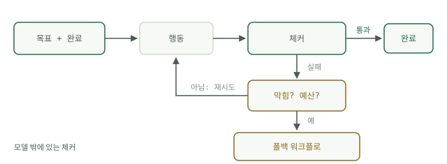

# 루프의 네 부분

프로덕션에서 살아남는 루프는 모두 같은 네 부분을 가집니다. 테스트할 수 있는 완료 정의가 있는 목표, 모델 밖에 있는 체커, 종료 조건, 그리고 턴과 달러 양쪽으로 센 예산입니다. 어느 하나를 빼면 루프가 단순해지는 것이 아니라 브레이크가 없어지는 것입니다. 이 페이지는 각 부분을 깊이 있게 다룬 뒤 표준 골격에 주석을 답니다.




<a id="a-goal-with-a-testable-done"></a>

## 테스트할 수 있는 완료 조건이 있는 목표

"오류 처리를 개선한다"는 루프를 끝낼 수 없습니다. 끝났다고 말해 줄 수 있는 것이 아무것도 없기 때문입니다. "`tests/` 아래 테스트가 모두 통과하고 린터가 아무것도 보고하지 않는다"는 끝낼 수 있습니다. 목표는 사람도 모델도 아닌 프로그램이 그것에 대해 참 또는 거짓을 돌려줄 수 있게 서술해야 합니다. 완료를 검사로 쓸 수 없다면 아직 루프에 맡길 수 있는 작업이 아니라 대화형 세션입니다. 완료를 마흔 줄짜리 스크립트로 쓰는 일은 그 자체로 하나의 기술이며, [목표 테스트 실습](../track-loop/build-goal-test.md)에서 구체적으로 만듭니다.

<a id="a-checker-outside-the-model"></a>

## 모델 밖의 체커

체커는 테스트 스위트, 컴파일러, 린터, 스키마 검증기입니다. 모델의 의견을 묻지 않고 결과를 판정하는 기계적인 것이면 무엇이든 됩니다. 자기 검토는 체커가 아닙니다. 여기에는 직접적인 증거가 있습니다. Huang 외의 "Large Language Models Cannot Self-Correct Reasoning Yet"(ICLR 2024)은 모델이 외부 피드백 없이는 자신의 추론을 바로잡기 어려우며, 자기 수정 뒤에 성능이 오히려 나빠지기도 한다는 것을 발견했습니다. 모델이 자기 작업을 채점하는 것은 같은 가중치가 같은 실수를 두 번 하는 것이고, 이번에는 확신까지 더 얹습니다. 그래서 외부 체커는 타협할 수 없는 조건입니다. 루프를 수렴시키는 피드백은 오류를 만든 쪽 바깥에서 와야 합니다. 코딩이 루프가 가장 말을 잘 듣는 영역인 까닭이 이것입니다. 컴파일러와 테스트 러너는 공짜이고 빠르며 외부에 있는 체커로, 그 영역에 기본으로 딸려 옵니다.

<a id="a-stop-rule"></a>

## 종료 조건

출구는 세 개이고, 어느 하나만 충족해도 실행이 끝납니다. 체커가 통과하거나(성공), 턴 한도에 닿거나(시도 소진), 연속 두 번의 시도가 같은 경우(루프가 헛돌고 있어 턴을 더 써 봐야 돈만 나갑니다)입니다. 마지막이 중요한 까닭은 헛돎이 조용하기 때문입니다. 같은 실패 테스트, 같은 빈 diff가 시도마다 되풀이됩니다. 래칫과 핑거프린팅을 포함한 브레이크의 전체 목록은 [종료 조건](../track-loop/stop-conditions.md)에 있습니다.

<a id="a-budget-in-turns-and-dollars"></a>

## 턴과 달러로 센 예산

턴과 달러는 서로 다르게 무너지므로 둘 다 상한을 둡니다. 턴 상한은 시도 횟수를 묶고, 달러 상한은 한 턴이 부풀 때의 피해를 묶습니다. 거대한 페이로드를 돌려주는 도구 호출 하나가 평범한 턴 열 번보다 비쌀 수 있습니다. 턴 상한만 있고 지출 상한이 없는 루프는 상한을 알 수 없는 청구서입니다.

<a id="the-skeleton-annotated"></a>

## 주석 달린 골격

```python
for turn in range(MAX_TURNS):                      # budget, part one: turns
    action = model.next_step(goal, history)        # the model chooses the step
    result = run(action)                           # the world responds
    history.append(result)                         # the observation survives
    if checker(result):                            # external judge, never the model
        break                                      # stop rule 1: done
    if repeated(history, 2):                       # stop rule 2: spinning
        break
    if spent() > BUDGET:                           # budget, part two: dollars
        break
else:
    fallback_workflow(goal)                        # turns exhausted: fixed path
```

출구를 꼼꼼히 읽으십시오. Python `for`의 `else`는 루프가 `break` 없이 끝났을 때만 실행되므로, 적힌 대로라면 잡아내는 실패 모드는 딱 하나, 턴 소진뿐입니다. `repeated`와 예산 `break`는 결과 없이 빠져나가므로, 프로덕션에서는 체커 통과가 아닌 모든 출구를 같은 곳으로 보냅니다. 폴백 워크플로입니다. 모델 없이도 근거 있는 답을 내는 결정적 경로입니다. 그 버전을 [루프 실습](loop-practice.md)에서 끝까지 연결해 봅니다.

골격이 무엇을 빼놓았는지도 눈여겨보십시오. "모델에게 만족하는지 물어본다"는 줄이 없습니다. 모델은 다음 단계를 고르지만, 일이 끝났는지에 대해서는 한 표도 행사하지 못합니다.
