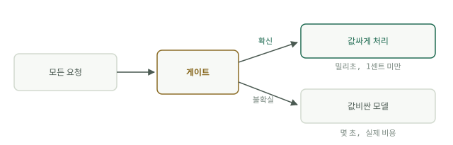

# 값싼 결정

에이전트는 두 종류의 일을 합니다. 쓰는 일(요약, 계획, 답장, 코드)과 결정하는 일(이게 급한가, 어느 폴더에 속하는가, 사람이 필요한가)입니다. 쓰는 일은 끝이 열려 있어 정말로 큰 모델이 필요합니다. 결정하는 일은 한계가 있습니다. 답이 이미 아는 집합 안에서 나옵니다. 대부분의 파이프라인은 두 종류의 일을 같은 프런티어 모델에 보내는데, 변호사에게 돈을 주고 봉투를 분류시키는 셈입니다.

이 모듈은 게이트를 다룹니다. 값비싼 모델 앞에 놓여 스트림을 분류하는 값싼 결정 계층으로, 프런티어 모델은 정말로 판단이 필요한 항목만 보게 됩니다.

이름에 대한 참고입니다. 이 모듈은 패턴의 이름을 따서 게이트라고 부릅니다. 심화 핸드북은 [Jev 엔지니어링](../track-jev/system-one-models.md)으로, 게이트 자리에 가장 자주 들어서는 시스템 1 모델 부류의 이름을 땄습니다. 하나는 패턴이고, 다른 하나는 그 패턴을 만드는 강력한 방법 하나입니다.

## 두 종류의 일

에이전트가 받은 편지함을 처리하는 모습을 지켜보며 결정의 수를 세어 보십시오. 스팸인가. 뉴스레터인가. 어느 프로젝트와 관련되는가. 답장이 필요한가. 이 모두를 거친 뒤에야 쓰는 일이 일어나며, 대부분의 항목에서는 끝내 일어나지 않습니다. 항목은 정리되거나, 보관되거나, 폐기됩니다. 프런티어 모델이 "이게 뉴스레터인가"에 답하느라 몇 초와 실제 돈을 태워 얻는 것은 정보 1비트입니다. 그 결정의 가치는 1센트의 몇 분의 일이었습니다. 쓰는 일은 그것이 필요한 드문 항목에서 정가를 치를 만합니다.

## 게이트란 무엇인가

게이트는 항목마다 좁은 질문 하나를 던지고 그 답에 따라 경로를 정합니다. 모양은 언제나 같습니다. 모든 것이 들어오고, 항목마다 한계가 있는 질문, 즉 이 레이블들 중 하나인지, 예인지 아니오인지, 점수가 얼마인지를 받습니다. 게이트가 확신을 갖고 답할 수 있는 일상적인 항목은 값싼 결정적 코드가 처리하고, 게이트가 확신하지 못하는 항목은 모두 메인 모델로 넘어갑니다. 확신이 없으면 에스컬레이션합니다. 게이트는 유일한 경로가 아니라 빠른 경로일 뿐입니다.

## 게이트의 분류

비용과 오류 가능성이 높아지는 순서로 네 가지 도구입니다.

- **규칙.** 정규 표현식, 발신자 허용 목록, "수신 거부 링크가 있는가". 공짜이고 즉각적이지만, 예상하지 못한 것은 전혀 보지 못합니다. 언제나 첫 계층이며, 마지막 계층이 되어서는 안 됩니다.
- **고전적인 분류기.** TF-IDF 특징 위에 얹은 로지스틱 회귀 또는 그 비슷한 모델로, 직접 레이블링한 수백 개의 예시로 학습시킵니다. 내 컴퓨터에서 마이크로초 단위로 돌고, 호출당 비용이 없으며, 실수도 들여다볼 수 있습니다.
- **작은 LLM.** 한 단어로 답하도록 프롬프트한 Haiku급 모델입니다. 학습 데이터가 필요 없고 새로운 상황에도 대응하지만, 값싼 선택지 중에서는 가장 느리고 가장 비싸며, 답을 얻으려면 텍스트를 파싱해야 합니다.
- **시스템 1 모델.** TypeSafe AI가 2026년 9월에 내놓은 Jev가 그 첫 사례입니다. 타입이 있는 결정, 즉 예/아니오, 최대 255개 선택지 중 하나, 또는 순서 척도 위의 스칼라를 내놓으며, 결정마다 신뢰도 점수가 붙고 텍스트 생성은 전혀 하지 않습니다. 배경은 [시스템 1 모델](../track-jev/system-one-models.md)에 있습니다.

## 게이트가 놓일 곳

스트림이 모여드는 곳이면 어디든 됩니다. 인제스트 단계에서, 무엇이든 메인 에이전트에 닿기 전에 둡니다. 스팸, 중복, 순수 참고 자료는 프런티어 토큰을 한 개도 써서는 안 됩니다. 값비싼 도구 호출 앞에도 둡니다. "이 질의에 웹이 필요한가"가 게이트입니다. 그리고 행동 주변에 가드레일로 둡니다. "이것이 파괴적인가"를 예/아니오로 묻고, 임계값을 넘으면 막습니다. 계층으로 쌓으십시오. 규칙이 먼저, 분류기가 두 번째, 앞의 두 단계를 통과한 것만 모델이 맡습니다.

게이트는 아키텍처 결정이지 벤더 결정이 아닙니다. 아키텍처, 즉 좁은 질문, 값싼 답, 의심스러우면 에스컬레이션은 어떤 도구가 그 자리를 채우든 그대로입니다. 어떤 도구여야 하는지는 직접 만든 레이블로 답하는 경험적 질문이고, 다음 페이지인 [실전 게이트](gates-in-practice.md)의 주제입니다.
