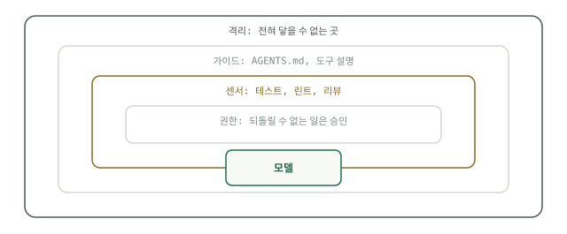

# 네 개의 고리

하네스는 바깥에서 안쪽으로 세웁니다. 격리, 가이드, 센서, 권한 순서입니다. 순서가 중요한 이유는 각 고리가 그 안쪽의 모든 고리가 무너져도 버텨야 하기 때문입니다. 가이드는 무시될 수 있고, 센서는 놓칠 수 있고, 승인은 잘못 클릭될 수 있습니다. 벽은 그런 일에 개의치 않습니다. 그래서 가장 바깥 고리를 첫 프롬프트를 쓰기 전에 먼저 세웁니다.



<a id="ring-one-containment"></a>

## 첫째 고리: 격리

격리는 에이전트가 물리적으로 닿을 수 없는 범위를 정하는 일이며, 모델의 협조가 전혀 없어도 작동하는 유일한 고리입니다. 표준 구성은 이렇습니다. 노트북의 셸이 아니라 컨테이너나 VM, main이 아니라 버려도 되는 브랜치나 git 워크트리, 애플리케이션의 자격 증명이 아니라 읽기 전용 데이터베이스 사용자, 열린 인터넷이 아니라 네트워크 허용 목록입니다. 이 가운데 프롬프트가 필요한 것은 하나도 없습니다. 에이전트의 첫 실행 전에 갖춰 두면, 최악의 세션도 버려지는 브랜치 하나와 낭비된 API 비용으로 끝납니다.

<a id="ring-two-guides"></a>

## 둘째 고리: 가이드

가이드는 에이전트가 행동하기 전에 읽는 모든 것입니다. AGENTS.md 파일, 도구 설명, 예시가 그렇습니다. 만드는 비용이 적게 들고, 일상적인 품질의 대부분을 떠받칩니다. 쓸모 있는 AGENTS.md는 네 쪽이 아니라 네 줄입니다.

```markdown
- Monorepo: services live in services/, shared code in packages/. Run everything from the repo root.
- `make test` must pass before you call any task done.
- Never hand-edit files in migrations/ — generate them with `make migration`.
- Your database user is read-only. Ask before proposing any schema change.
```

도구 설계가 이 고리의 나머지 절반입니다. Google의 Kaggle 화이트페이퍼 [Agent Tools & Interoperability with MCP](https://www.kaggle.com/whitepaper-agent-tools-and-interoperability-with-mcp)는 도구를 함수 도구, 내장 도구, 에이전트 도구로 나누는데, 그 모범 사례는 모두 가이드를 쓰는 일에 관한 것입니다. 모델이 설명만 보고 고를 수 있을 만큼 각 도구를 잘 문서화하고, API 표면이 아니라 작업을 기준으로 도구를 설계하고, 출력은 간결하게 돌려주고, 오류가 해결 방법을 알려 주게 하라는 것입니다. 원시 접근보다 타입이 있는 도구를 택하십시오. `search_orders(customer_id)`가 SQL 연결을 통째로 넘겨주는 것보다 낫습니다. 스키마 자체가 격리이기 때문입니다. 화이트페이퍼가 MCP를 옹호하는 이유는 상호운용성입니다. 열린 프로토콜 하나(stdio 또는 스트리밍 가능한 HTTP 위의 JSON-RPC 2.0)면 클라이언트 N개와 도구 서버 M개가 각각 한 번씩만 통합하면 되고, N×M번 통합할 필요가 없습니다. 전체 내용은 [도구와 MCP](../track-harness/tools-and-mcp.md)에 있습니다.

<a id="ring-three-sensors"></a>

## 셋째 고리: 센서

센서는 작업이 건전한지를 결정론적으로 알려 줍니다. 값싼 센서는 모든 변경에 돌리십시오. 린터, 타입 체커, 변경할 때마다 도는 테스트 스위트는 몇 초밖에 걸리지 않고 지치지도 않습니다. 비싼 센서(diff를 검토하는 두 번째 모델, 직접 읽는 사람)는 중요한 곳에만 쓰십시오. 인증 코드, 마이그레이션, 돈이 오가는 모든 것입니다. `make test`가 자동으로 도는 하네스는 검토자가 기억해 주기를 바라는 하네스보다 더 많이 잡아냅니다.

<a id="ring-four-permissions"></a>

## 넷째 고리: 권한

Anthropic에 따르면 [Claude Code 사용자는 권한 요청의 93%를 승인합니다](https://www.anthropic.com/engineering/claude-code-auto-mode). 100번 중 93번 열리는 게이트는 사람들이 읽지 않게 만듭니다. 진짜 보호는 첫째 고리, 곧 아예 쓸 수 없는 행동에서 나옵니다. 그러니 승인 요청은 정말 되돌릴 수 없는 일에만 쓰십시오. 공유 브랜치에 푸시하기, 무엇이든 보내기, 무엇이든 지우기입니다. 하루 세 번의 요청은 읽히지만 서른 번의 요청은 클릭만 됩니다.

<a id="hooks-guides-with-teeth"></a>

## 훅: 강제력 있는 가이드

모델이 대충 훑어볼 수 있는 가이드가 하네스가 강제하는 규칙이 됩니다. Claude Code에서는 PreToolUse 훅이 모든 도구 호출 전에 실행되어 그 호출을 막을 수 있습니다. 다음 훅은 "main에는 절대 푸시하지 않는다"를 강제합니다.

```json
{
  "hooks": {
    "PreToolUse": [
      {
        "matcher": "Bash",
        "hooks": [
          {
            "type": "command",
            "command": "jq -r '.tool_input.command' | grep -qE 'git push.*\\bmain\\b' && { echo 'Blocked: never push to main' >&2; exit 2; } || exit 0"
          }
        ]
      }
    ]
  }
}
```

종료 코드 2는 호출을 막고 메시지를 에이전트에 되돌려 줍니다. 그러면 에이전트는 조용히 실패하는 대신 방향을 고칩니다.

<a id="the-bets-expire"></a>

## 내기에는 유통기한이 있습니다

고리의 모든 구성 요소는 모델이 무언가를 하지 못한다는 데 건 내기입니다. Anthropic은 Claude Sonnet 4.5가 컨텍스트 한계 부근에서 작업을 조기에 마무리하는 탓에 하네스에 컨텍스트 리셋을 넣었고, Opus 4.5가 그러지 않게 되자 [그것을 아예 지웠습니다](https://www.anthropic.com/engineering/harness-design-long-running-apps). 여러분의 내기도 같은 식으로 만료됩니다. [하네스 실습](harness-practice.md)은 이것을 분기마다 하는 의식으로 만듭니다.
