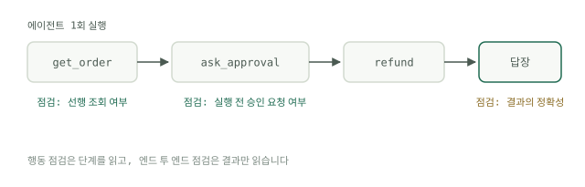

# 두 가지 점검

앞선 모듈에서는 계획을 세우고, 도구를 호출하고, 볼트를 편집하는 에이전트를 만들었습니다. 이 모듈은 그것이 제대로 동작하는지를 사용자가 알려 주기 전에 아는 방법을 다룹니다. 에이전트 평가(eval)의 모든 것은 하나의 구분 위에 서 있습니다. 결과에 대한 점검과 행동에 대한 점검입니다. 둘 다 필요하고, 서로 다른 질문에 답합니다.

## 엔드투엔드 점검

엔드투엔드 점검은 질문 하나만 합니다. 최종 답이 맞게 나왔는가? 입력을 실행하고, 마지막 메시지나 결과 상태를 가져와 채점합니다. 정확 일치일 수도, 루브릭일 수도, 판정자일 수도 있습니다. 사용자가 설계했을 법한 점검인데, 사용자가 실제로 경험하는 것을 재기 때문입니다.

강점이 곧 한계입니다. 프롬프트를 고친 뒤 통과율이 84%에서 71%로 떨어졌을 때, 엔드투엔드 스위트는 점수가 움직였다는 사실은 알려 주지만 그 이유는 알려 주지 않습니다. 실패한 트랜스크립트는 여전히 하나씩 읽어야 합니다. 실패가 검색에, 도구 인자에, 건너뛴 검증 단계에, 혹은 마지막 표현에 있을 수 있기 때문입니다. Google의 [Agent Quality whitepaper](https://www.kaggle.com/whitepaper-agent-quality)는 이것을 블랙박스 평가("에이전트가 사용자의 목표를 달성했는가?")로 보고, 거기에 밟아 온 경로를 들여다보는 글라스박스 관점을 짝지웁니다. 그 원칙을 요약한 말이 "궤적이 곧 진실이다(the trajectory is the truth)"입니다.

## 행동 점검

행동 점검은 답에 이르는 길에서 특정한 일 하나가 일어났는지를 묻습니다. 에이전트가 답하기 전에 검색을 호출했는가? 요청이 모호할 때 되물었는가? 작업이 끝났다고 말하기 전에 파일이 있는지 확인했는가? 점검은 하나하나가 좁고, 이진이며, 값쌉니다. 판단이 아니라 단언(assertion)입니다.

이득은 진단에 있습니다. 같은 환불 이메일을 내놓는 에이전트 둘도, 하나는 주문을 먼저 조회했고 다른 하나는 짐작했다면 같은 에이전트가 아닙니다. 엔드투엔드 점검은 둘에게 같은 점수를 주지만, 행동 점검은 짐작하는 쪽이 짐작이 틀리는 주문을 만나기 전인 오늘 둘을 갈라냅니다.

## 바탕이 되는 트레이스

행동 점검은 트레이스 위에서 돌아갑니다. 모델의 턴, 인자가 붙은 도구 호출, 도구 결과, 재시도를 모두 담은 기록입니다. 트레이스가 없으면 행동 점검도 없습니다. 그래서 화이트페이퍼는 에이전트에 첫 줄의 코드부터 평가를 위한 계측을 넣어야 하며, 로그, 트레이스, 지표가 관측 가능성(observability)의 세 기둥이라고 주장합니다. 에이전트가 Claude Code 구성이라면 트랜스크립트가 이미 트레이스이니, 그것을 기록해 두십시오. 그 위에서 무엇을 단언할지, 곧 도구 선택, 인자 추출, 순서 제약, 오류 처리는 [에이전트 평가](../track-evals/agent-evals.md)에서 깊이 다룹니다.

## 속도 예산

스위트를 두 계층으로 나눕니다. 빠른 계층은 결정론적인 행동 단언만 둡니다. 모델 호출도 네트워크도 없이 트레이스를 읽는 코드뿐입니다. 아무도 돌릴지 말지를 고민하지 않을 만큼 빨라야 하고, 몇 초, 이를테면 5초가 쓸 만한 예산입니다. 그보다 느려지면 편집할 때마다 도는 것이 아니라 병합 전에 돌리는 것이 되고, 피드백 루프는 죽습니다. 느린 계층인 판정자가 붙는 엔드투엔드 실행은 매일 밤과 릴리스 전에 돌립니다. [스위트 실습](../track-evals/build-suite.md)의 단일 파일 구조는 이 구분으로 자연스럽게 확장됩니다.

## 각 점검이 제값을 하는 곳

엔드투엔드 점검은 결정의 순간에 제값을 합니다. 릴리스를 내보낼 때, 모델을 바꿀 때, 프롬프트 둘을 비교할 때입니다. 행동 점검은 개발 중에 제값을 합니다. 한 가지를 바꾸고, 그것이 무엇을 건드렸는지 몇 초 안에 알고 싶을 때입니다.

첫날부터 피해야 할 함정이 하나 있습니다. 전체 통과율이 아니라 개별 점검을 지켜보십시오. 한 행동이 조용히 망가지는 동안 총합은 오를 수 있습니다. 불안정한 케이스 다섯 개가 통과하기 시작하는데, 에이전트는 환불 전에 승인을 묻지 않게 되는 식입니다. 총합은 진전이라 말하고, 점검 단위의 이력은 사고라고 말합니다. 느린 계층을 채점하는 일은 그 자체로 별개의 문제이고, 여기서 [판정자와 골든 세트](judges-and-golden-sets.md)가 등장합니다.
