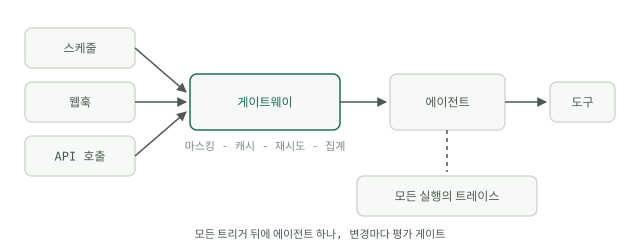

# 프로토타입에서 프로덕션으로

지금까지의 모든 모듈은 여러분의 컴퓨터에서 동작하는 무언가로 끝났습니다. 이 모듈은 다른 사람들, 혹은 새벽 3시의 스케줄러가 그것에 의존하기 시작할 때 무슨 일이 벌어지는지를 다룹니다. Google의 *Prototype to Production* 백서(Kaggle, 2025년 11월)는 솔직한 말로 시작합니다. "에이전트를 만드는 일은 쉽다. 그것을 신뢰하는 일은 어렵다." 에이전트를 내보내는 노력의 약 80%는 에이전트를 더 똑똑하게 만드는 데가 아니라 인프라, 보안, 검증에 들어간다는 것이 백서의 추정입니다.

## 데모가 트래픽을 만나면 무엇이 깨지는가

데모는 여러분이 지켜볼 때, 여러분이 고른 입력으로, 여러분 자신의 자격 증명으로 돌아갑니다. 프로덕션은 이 세 가지 편의를 한꺼번에 없앱니다. 실패 목록은 예측할 수 있습니다.

- **신뢰성.** 공급자는 타임아웃을 내고, 요청을 제한하고, 가끔 쓰레기를 돌려줍니다. 백오프를 둔 재시도와 멱등 도구가 없으면 불안정한 호출 하나가 실행 전체를 망치고, 멱등하지 않은 도구를 재시도하면 이메일이 두 번 나갑니다.
- **비용.** 여러분이 붙어서 지켜볼 때는 40센트인 루프가, 지켜보지 않을 때는 제멋대로 돈을 씁니다. 한도 없는 실행에는 무엇보다 먼저 [턴과 달러 상한](../course-2-loop/loops-vs-workflows.md)이 필요합니다.
- **입력.** 실제 트래픽에는 깨진 파일, 악의적인 텍스트, 테스트 프롬프트 세 개로는 닿지 못한 경계 사례가 들어 있습니다.
- **변경.** 데모에서 프롬프트는 마지막으로 붙여넣은 곳 어디엔가 있습니다. 프로덕션에서 추적되지 않는 프롬프트 수정은 검토할 수 없는 배포입니다.

백서는 이 변화를 AgentOps라는 규율로 설명합니다. 수동 점검은 자동화된 게이트가 되고, 그때그때의 손질은 버전이 매겨진 프롬프트와 도구가 되고, "괜찮아 보였다"는 로그, 트레이스, 지표가 됩니다.

## 세 가지 배포 형태, 하나의 에이전트

프로덕션 에이전트는 세 가지 방식으로 호출됩니다. **스케줄**(매일 밤의 요약), **이벤트**(파일이 도착하거나 웹훅이 발동), 혹은 **API** 뒤(사람이나 다른 시스템이 지금 당장 요청)입니다. Palantir의 AIP 아키텍처가 바로 이 세 가지를 설명합니다. 스케줄 기반 자동화, 거의 실시간인 이벤트 기반 자동화, API 기반 운영이며, 모두 같은 기반 데이터와 액션 계층 위에서 돌아갑니다.

설계에 주는 함의는 에이전트의 로직을 트리거와 분리하라는 것입니다. 에이전트 정의는 하나, 얇은 어댑터는 셋입니다. 스케줄 버전과 API 버전이 두 개의 코드베이스라면 수정이 있을 때마다 두 번씩 반영해야 하고, 둘 중 하나는 어긋나게 됩니다.

## 모든 모델 호출 앞의 게이트웨이 하나

가장 효과가 큰 인프라는 게이트웨이입니다. 모든 모델 호출이 예외 없이 지나가는 단일 관문입니다. 게이트웨이는 네 가지 일을 합니다.

- **마스킹.** 민감한 필드가 경계를 벗어나기 전에 제거하거나 가명 처리합니다.
- **캐싱.** 반복되는 프리픽스와 동일한 호출에는 캐시된 응답을 돌려줍니다.
- **재시도와 페일오버.** 백오프, 공급자 대체, 킬 스위치를 한곳에 둡니다.
- **토큰 집계.** 모든 호출에 누가 촉발했는지와 비용이 얼마였는지를 표시합니다.

성숙한 스택이 수렴하는 패턴이 이것입니다. Palantir는 각 애플리케이션이 공급자를 직접 호출하도록 두지 않고, 모든 LLM 접근을 토큰 소비 추적과 통일된 감사 로깅이 있는 보안 통합 계층으로 보냅니다. 이 구조를 따라 하는 데 Palantir가 필요하지는 않습니다. 200줄짜리 프록시면 대부분을 얻습니다.

## 백서가 그리는 경로

백서가 제시하는 프로덕션 경로는 출시가 아니라 생애 주기입니다. 개발(빠른 실험), 스테이징(자동화된 테스트와 모의 부하), 프로덕션(모니터링을 곁들인 점진적 롤아웃)입니다. 릴리스는 카나리나 블루-그린 배포로 내보내고 즉시 롤백할 수 있어야 하며, 100%를 한 번에 전환하지 않습니다. 평가 스위트는 CI에서 돌고 점수가 떨어지면 배포를 막습니다. 모듈 5의 [두 가지 점검](../course-5-evals/two-kinds-of-checks.md)은 대시보드가 아니라 게이트가 됩니다. 그리고 루프가 닫힙니다. 프로덕션 트레이스가 평가 세트를 채우고, 그것이 다음 릴리스를 단단하게 합니다.

이 가운데 특별한 것은 없습니다. 우연히 확률적인 구성 요소에 적용한, 평범한 소프트웨어 규율입니다. 다음 글은 운영 쪽을 다룹니다. [돌아가기 시작한 뒤에 그것을 지켜보고, 비용을 대고, 지키는 일](operating-agents.md)입니다.
